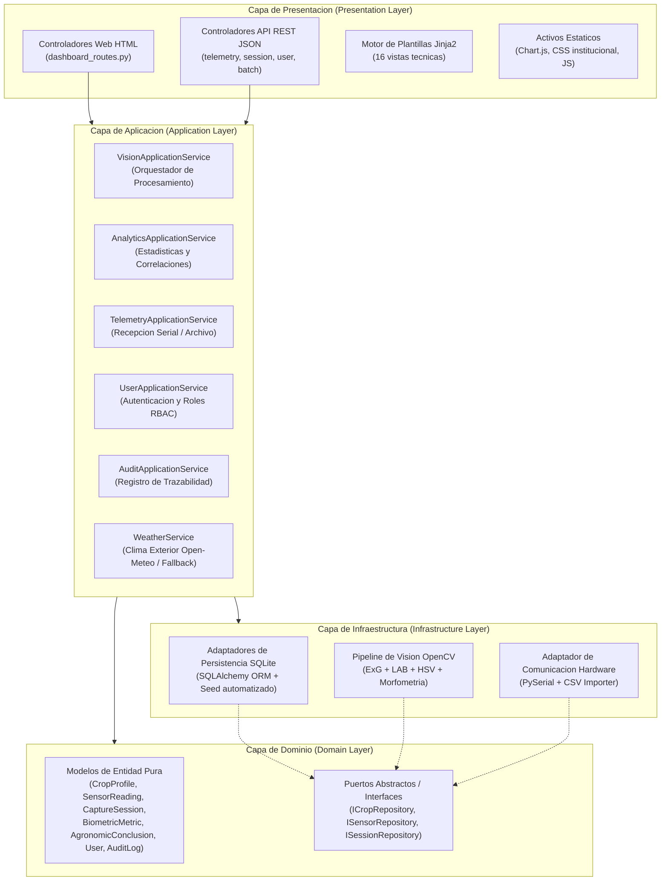
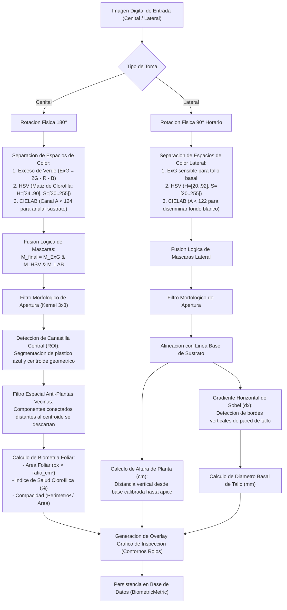
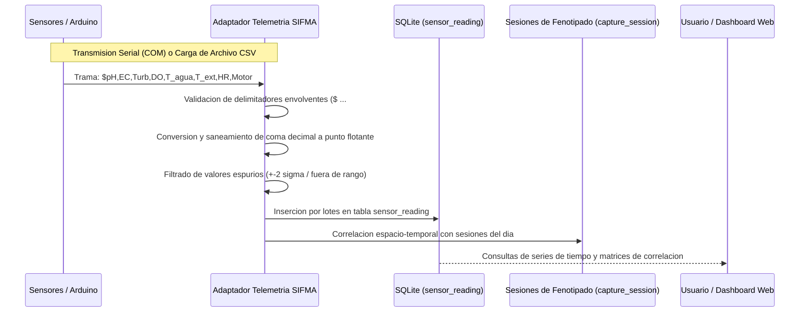
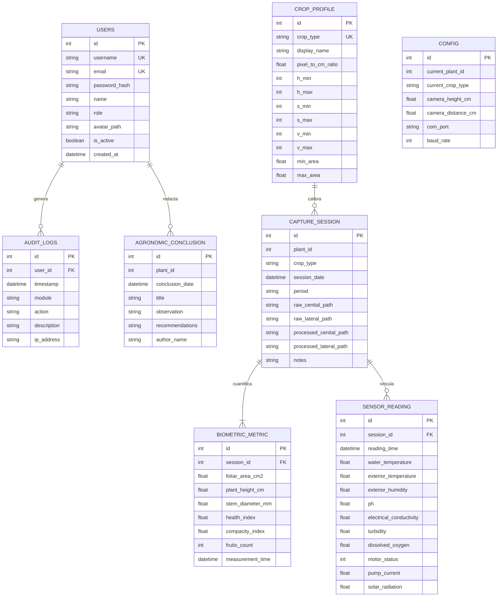

# SIFMA — Documento Técnico de Arquitectura y Procedimientos del Software

**Obra:** SIFMA — Sistema Integral de Fenotipado y Monitoreo Agrícola en Torres Hidropónicas Verticales  
**Versión:** 1.0.0  
**Año de creación:** 2026  
**Finalidad del documento:** Descripción técnica formal de procedimientos y arquitectura para el depósito y registro de soporte lógico (software) ante la Dirección Nacional de Derecho de Autor (DNDA), República de Colombia.  
**Autores (desarrolladores del código fuente):**  
- Andrés Felipe Luna Camargo  
- Cristian David Peña Martínez  
**Titular de los derechos patrimoniales:** `[POR DEFINIR]` (pendiente de formalización entre los autores y la Universidad del Magdalena)  

---

## 1. Identificación y Alcance de la Obra

SIFMA es un soporte lógico integral concebido para la adquisición, procesamiento, cuantificación biométrica no destructiva y telemetría microclimática en sistemas de agricultura vertical de precisión (torres aeropónicas e hidropónicas).

El software resuelve el problema de la variabilidad fisiológica intra-torre mediante dos subsistemas computacionales coordinados:
1. **Subsistema Embebido de Captura en Campo (`raspi_node`):** Opera en una computadora de placa reducida (Raspberry Pi 5) acoplada a la estructura de cultivo. Controla dos cámaras digitales de alta resolución en orientación ortogonal (cenital y lateral), programando jornadas periódicas de captura y almacenando los lotes en memoria física masiva USB.
2. **Subsistema Central de Servidor y Analítica (`local_server`):** Opera en una estación de trabajo local sin requerir conexión a internet. Procesa los lotes mediante un pipeline de visión computacional, decodifica telemetría de sensores fisicoquímicos en tiempo real o diferido, estructura la información en una base de datos relacional y ofrece una interfaz web de visualización ejecutiva, análisis estadístico multivariable y generación de reportes científicos con firma digital.

---

## 2. Arquitectura General del Sistema

El software está implementado bajo un patrón de **Arquitectura Hexagonal (Puertos y Adaptadores / Clean Architecture)**, desacoplando estrictamente el dominio científico de las tecnologías de persistencia, interfaz gráfica y protocolos de comunicación de hardware.

---

## 3. Desglose Modular y Responsabilidades

### 3.1 Servidor Local (`local_server/`)

| Módulo / Paquete | Responsabilidad Técnica |
| :--- | :--- |
| **`app.py`** | Punto de entrada del servidor. Implementa el patrón *Application Factory*, inicializa extensiones SQLAlchemy, configura el modo WAL de SQLite y registra blueprints. |
| **`core/`** | Parámetros de configuración inmutables (`config.py`), registro de eventos de sistema (`logger.py`), verificación dinámica de librerías (`dependencies.py`) y políticas de saneamiento criptográfico (`security.py`). |
| **`domain/models/`** | Declaración de entidades agronómicas y de telemetría: perfiles de especie (`CropProfile`), registros ambientales (`SensorReading`), sesiones fotográficas (`CaptureSession`), mediciones morfométricas (`BiometricMetric`), notas de bitácora (`AgronomicConclusion`), usuarios (`User`) y bitácora de eventos (`AuditLog`). |
| **`infrastructure/database/`** | Conexión relacional, esquemas de persistencia y sembrado inicial de datos maestros (`seed.py`), garantizando creación automática de tablas y roles. |
| **`infrastructure/vision/`** | Implementación del motor de visión por computadora: gestor de pipeline (`pipeline_manager.py`), calculadora morfométrica (`biometric_calculator.py`) y estrategia de segmentación vegetal (`strategies/exg_segmentation.py`). |
| **`infrastructure/telemetry/`** | Driver de comunicación con hardware transmisor por puerto serie COM (`serial_adapter.py`) y motor de importación masiva de archivos CSV (`csv_importer.py`). |
| **`application/services/`** | Lógica de negocio y orquestación de casos de uso: cálculo de curvas de correlación de Pearson, ingestión de fotos de USB, autenticación y auditoría. |
| **`presentation/web/`** | Controladores HTTP para renderizado de vistas HTML Jinja2 (Dashboard, Calendario, Visión, Sensores, Correlaciones, Dossier Científico, Usuarios). |
| **`presentation/api/`** | Endpoints RESTful para intercambio de datos JSON con el frontend y exportación de archivos CSV tabulares. |

### 3.2 Nodo Embebido Raspberry Pi (`raspi_node/`)

| Módulo / Archivo | Responsabilidad Técnica |
| :--- | :--- |
| **`main_capture.py`** | Demonio de sistema (*systemd service*). Ejecuta el bucle temporal de muestreo, sincroniza los disparos de ambas cámaras CSI y estructura las carpetas en la memoria USB. |
| **`calibrate_cameras.py`** | Utilidad gráfica basada en Tkinter para enfoque óptico manual en tiempo real, detección de punto focal y ajuste de planos mecánicos. |
| **`panel_touch_lite.py`** | Interfaz de usuario táctil nativa optimizada para pantallas LCD DSI oficiales de Raspberry Pi, con consumo inferior a 15 MB de RAM. |
| **`services/camera_service.py`** | Abstracción multi-backend para control de cámara con priorización dinámica: Picamera2 (nativo libcamera) > `rpicam-still` (binario) > OpenCV VideoCapture (V4L2). |
| **`services/storage_service.py`** | Montaje y detección de particiones en unidades USB desmontables, asegurando escritura íntegra con llamada POSIX `sync`. |

---

## 4. Algoritmos y Procedimientos Detallados

### 4.1 Pipeline de Visión Computacional (Fenotipado Foliar y Morfometría)

El procesamiento de imágenes no recurre a modelos opacos o redes neuronales con requerimientos de GPU, sino a un pipeline determinista basado en colorimetría de precisión, umbralización estocástica y geometría computacional.

#### Justificación del Índice de Exceso de Verde ($ExG$):
En las capturas cenitales, la iluminación cenital combinada con el reflejo de la arlita húmeda y el plástico de la canastilla genera ruido en espacios RGB estándar. Se implementa el índice normalizado:
$$ExG = 2 \cdot G - R - B$$
Dado que el tejido vegetal fotosintéticamente activo presenta una reflectancia máxima en el canal verde ($G \gg R, B$), el valor de $ExG$ es marcadamente positivo ($>10$) en la masa foliar viva, mientras que la piel humana, la arlita arcillosa ($R > G$) y el marco blanco de la torre ($R \approx G \approx B$) producen valores menores o iguales a cero.

#### Detección de Diámetro de Tallo mediante Gradiente de Sobel:
Para medir el calibre del tallo lateral sin contacto físico:
1. Se define un recuadro de interés (ROI) en la base de la planta, delimitado horizontalmente por la línea de la maceta y con una altura vertical de escaneo de 40 a 60 píxeles.
2. Se aplica un operador de convolución Sobel horizontal en escala de grises:
   $$G_x = \begin{bmatrix} -1 & 0 & 1 \\ -2 & 0 & 2 \\ -1 & 0 & 1 \end{bmatrix} * I$$
3. Se calcula el perfil de proyección vertical promedio del gradiente. El pico positivo del gradiente identifica la pared izquierda del tallo cilíndrico, mientras que el pico negativo identifica la pared derecha.
4. La distancia euclidiana entre ambos picos, convertida a unidades métricas mediante el factor de calibración óptico, entrega el diámetro basal exacto en milímetros.

---

### 4.2 Ingestión y Procesamiento de Telemetría Ambiental

El sistema soporta la captura de ocho variables microclimáticas y fisicoquímicas:

---

### 4.3 Generación del Dossier y Reporte Científico

El módulo de reportes consolida los datos de fenotipado y microclima en una ficha técnica con rigor editorial:
1. **Extracción y Agregación Estadística:** Recupera todas las lecturas de sensores de la jornada seleccionada y calcula:
   - Media aritmética ($\mu$)
   - Desviación estándar muestral ($\sigma$)
   - Mediana y Rango Intercuartílico ($IQR = Q_3 - Q_1$)
   - Coeficiente de variación ($CV\% = \frac{\sigma}{\mu} \cdot 100$)
2. **Matriz de Correlación de Pearson ($r$):** Cuantifica la relación lineal entre cada métrica foliar ($x$) y cada variable ambiental ($y$):
   $$r_{xy} = \frac{\sum_{i=1}^{n} (x_i - \bar{x})(y_i - \bar{y})}{\sqrt{\sum_{i=1}^{n} (x_i - \bar{x})^2} \sqrt{\sum_{i=1}^{n} (y_i - \bar{y})^2}}$$
3. **Compilación Jinja2:** Ensambla dinámicamente las secciones activadas por el usuario (tablas, gráficas de tendencia, registro fotográfico y bitácora).
4. **Firma Digital Biométrica:** Incorpora firmas capturadas en pantalla táctil o trazadas con el cursor mediante HTML5 Canvas, almacenadas en formato DataURL Base64 y estampadas con fecha y rol del investigador.

---

## 5. Modelo Relacional de Datos

---

## 6. Justificación Técnica de Decisiones de Diseño

1. **Selección de Python y Flask:**
   Python ofrece acceso directo y sin fisuras al ecosistema científico de NumPy y OpenCV. El framework Flask aporta un núcleo ligero que no impone dependencias innecesarias de bases de datos externas ni overhead de servidores empresariales pesados, permitiendo una instalación desatendida mediante simples scripts batch en cualquier equipo Windows convencional.
2. **SQLite con Modo WAL (Write-Ahead Logging):**
   A diferencia del modo predeterminado de SQLite que bloquea el archivo entero ante cualquier escritura, el modo WAL (`PRAGMA journal_mode=WAL`) permite lecturas concurrentes ilimitadas desde el dashboard web mientras el hilo receptor de telemetría escribe lecturas a intervalos de un segundo, eliminando por completo errores de base de datos bloqueada (`database locked`).
3. **Visión por Computadora Determinista vs. Deep Learning:**
   El fenotipado agronómico en torres comerciales requiere reproducibilidad matemática certificable. Las redes neuronales profundas introducen un comportamiento estocástico de caja negra, pesan cientos de megabytes y demandan aceleración por GPU. El pipeline implementado en SIFMA entrega tiempos de respuesta menores a 2.5 segundos en CPUs de gama media, con invariabilidad de resultados y bajo consumo energético.
4. **Almacenamiento Desacoplado en USB:**
   En entornos agrícolas reales, los invernaderos carecen de cableado de red o cobertura Wi-Fi estable. La arquitectura de nodos aislados que escriben en particiones USB portátiles garantiza tolerancia total a caídas de red y aislamiento eléctrico ante perturbaciones de la red eléctrica.

