# SIFMA — Manual de Usuario y Operación del Sistema

**Obra:** SIFMA — Sistema Integral de Fenotipado y Monitoreo Agrícola en Torres Hidropónicas Verticales  
**Versión del documento:** 1.0.0  
**Fecha de emisión:** Noviembre de 2026  
**Autores (desarrolladores del software):**  
- Andrés Felipe Luna Camargo  
- Cristian David Peña Martínez  

---

## 1. Introducción y Propósito del Manual

El presente manual describe de forma pormenorizada las interfaces, funcionalidades y flujos de trabajo del software **SIFMA**. Ha sido estructurado para servir como guía de referencia para investigadores agronómicos, evaluadores técnicos de la Dirección Nacional de Derecho de Autor (DNDA) y operadores de campo.

Todas las figuras mostradas corresponden a capturas de pantalla reales del software en funcionamiento, tomadas en resolución nativa de 1920&times;1080 píxeles.

---

## 2. Acceso y Control de Autenticación

El acceso al sistema está protegido por un módulo de autenticación criptográfica que implementa control de acceso basado en roles (RBAC).

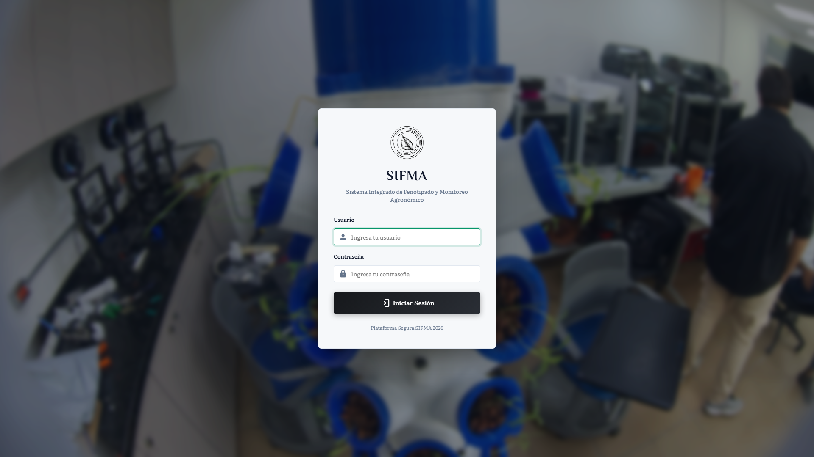
*Figura 1: Pantalla de inicio de sesión de SIFMA (`/login`). Autenticación mediante credenciales con hash SHA-256.*

### Procedimiento de Ingreso:
1. Abra el navegador web e ingrese a `http://127.0.0.1:5000`. Si no ha iniciado sesión, será redirigido automáticamente a la vista de login.
2. Ingrese el correo electrónico o nombre de usuario registrado.
3. Ingrese la contraseña asignada y presione el botón **"Acceder al Sistema"**.
4. El sistema validará las credenciales y redirigirá al usuario a su panel correspondiente según sus permisos de rol (Administrador, Investigador, Operador o Invitado).

---

## 3. Resumen Diario y Panel de Control Principal

El Dashboard principal (`/`) ofrece una panorámica inmediata de la jornada de cultivo activa.

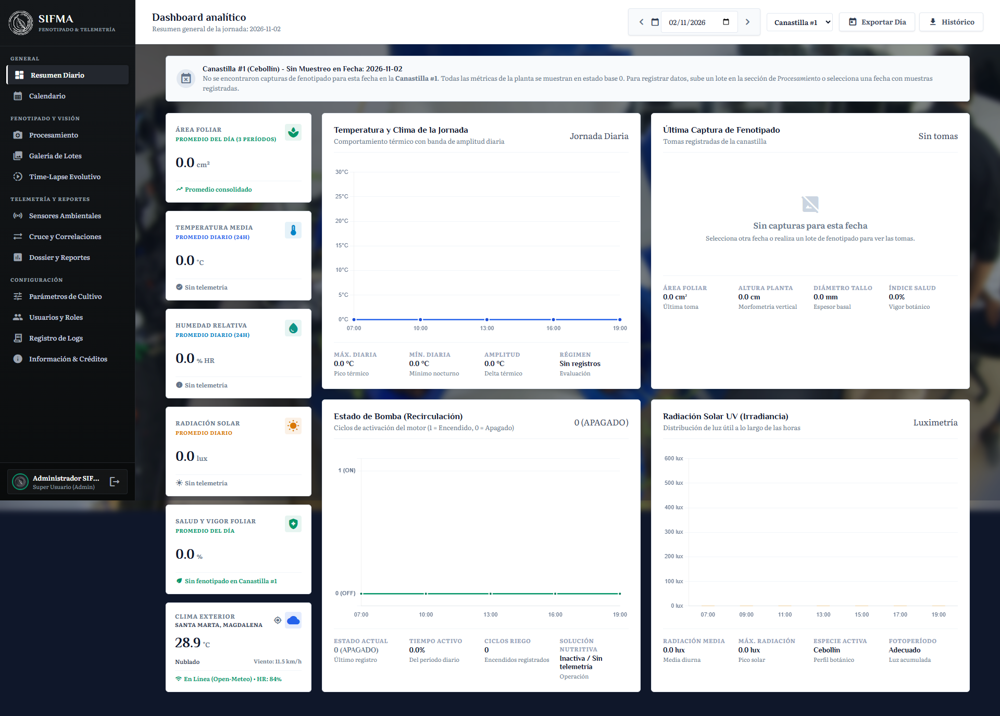
*Figura 2: Dashboard general de telemetría y fenotipado en tiempo real (`/`).*

### Componentes de la Interfaz:
- **Selector de Canastilla / Nivel:** Permite alternar entre los cuatro estratos verticales de la torre hidropónica (Canastilla 1 Base hasta Canastilla 4 Cúspide).
- **Tarjetas KPI de Estado Inmediato:** Indicadores numéricos de Temperatura Exterior (°C), Humedad Relativa (%), Radiación Solar (lux), Área Foliar ($cm^2$), Altura de Planta ($cm$) y Estado de Bomba de Recirculación.
- **Gráfica de Curva Térmica y Fotoperiodo:** Muestra la evolución horaria de la temperatura y la radiación a lo largo de las 24 horas del día.
- **Visualizador de Última Captura:** Muestra la última fotografía procesada con los contornos perimetrales foliares superpuestos en color rojo.

---

## 4. Calendario Interactivo de Muestreo

El módulo de calendario (`/calendar`) organiza cronológicamente la totalidad de las actividades fenotípicas y de registro de sensores.

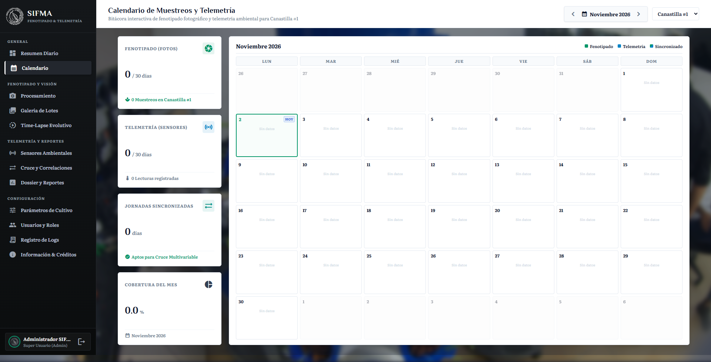
*Figura 3: Matriz de calendario mensual de adquisición fotográfica y telemetría (`/calendar`).*

### Operación del Calendario:
- **Navegación Temporal:** Los botones de flecha permiten retroceder o avanzar entre meses y años.
- **Insignias Verdes:** Indican días en los que se realizaron tomas fotográficas y procesamiento de biomasa foliar.
- **Insignias Azules:** Indican jornadas con almacenamiento continuo de telemetría ambiental.
- **Modal Inspector de Jornada:** Al hacer clic sobre cualquier celda numérica, el sistema despliega un cuadro con los turnos registrados (Mañana, Mediodía, Tarde), promedios de temperatura y accesos directos al informe científico de esa fecha.

---

## 5. Ingestión de Lotes y Procesamiento de Visión

El módulo de procesamiento (`/processing`) es el motor principal para cargar imágenes desde memorias USB o carpetas locales y ejecutar el pipeline de segmentación.

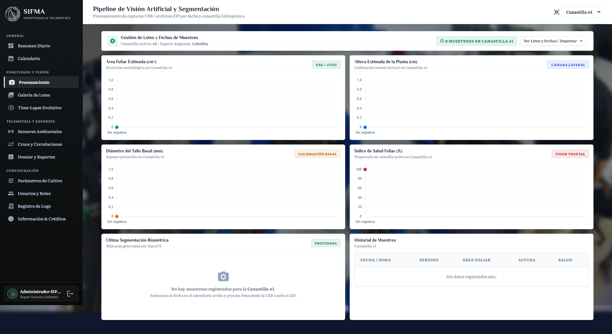
*Figura 4: Centro de procesamiento e ingestión de imágenes (`/processing`).*

### Opciones de Carga:
1. **Detección Automática de USB:** Al insertar una memoria USB formateada en FAT32/exFAT que contenga la estructura `SIFMA_CAPTURES/YYYY-MM-DD/`, el sistema detecta la unidad automáticamente y lista los lotes disponibles para procesamiento en un solo clic.
2. **Carga Manual Drag & Drop:** Permite arrastrar carpetas comprimidas `.zip` o pares de imágenes individuales directamente al navegador.

Al pulsar **"Procesar Lote"**, el algoritmo de visión ejecuta la segmentación y despliega la barra de progreso junto a las métricas resultantes ($cm^2$, salud %, altura y tallo).

---

## 6. Galería de Lotes y Comparador de Biomasa

La galería (`/gallery`) almacena el catálogo histórico de fotografías capturadas, permitiendo comparar el desarrollo vegetal en diferentes etapas.

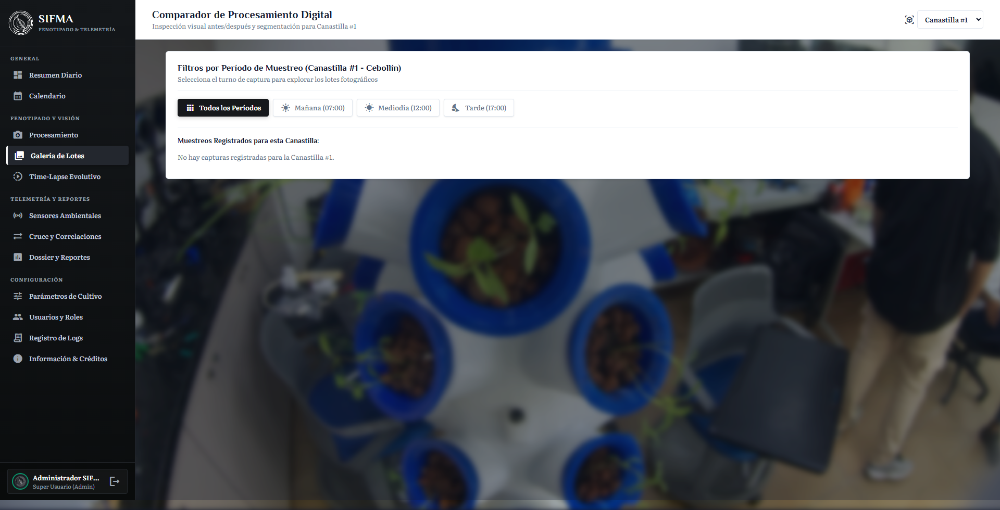
*Figura 5: Galería de capturas fenotípicas y máscaras procesadas (`/gallery`).*

### Herramientas de Inspección:
- **Filtro por Período:** Selección entre tomas de la Mañana (07:00), Mediodía (12:00) y Tarde (17:00).
- **Herramienta Lupa (Modo Inspección):** Al presionar la tecla `L`, el cursor se transforma en una lupa de aumento 3&times; para evaluar detalles de nervaduras foliares y posibles manchas patológicas.
- **Zoom y Pan:** Control continuo mediante rueda del ratón y arrastre de imagen para encuadres de alta resolución.

---

## 7. Visualizador Evolutivo Time-Lapse

El módulo Time-Lapse (`/timelapse`) genera una animación secuencial continua para evaluar la tasa de expansión foliar y el fototropismo del cultivo.

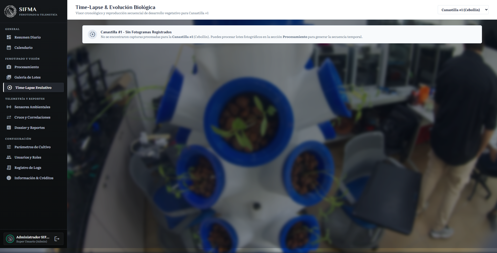
*Figura 6: Reproductor cronológico de desarrollo foliar (`/timelapse`).*

El reproductor incluye controles de reproducción, pausa, avance cuadro a cuadro, velocidad de animación (1&times; a 5&times;) y selector de vista (solo imagen original, solo máscara segmentada o vista superpuesta con contornos).

---

## 8. Telemetría y Microclima (8 Sensores)

La sección de sensores (`/sensors`) monitorea el perfil fisicoquímico completo de la solución nutritiva y del aire.

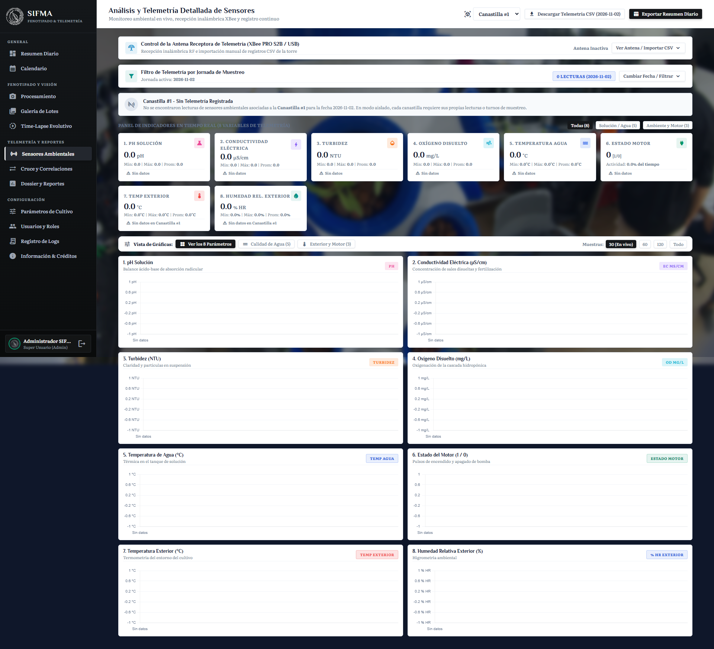
*Figura 7: Panel de telemetría de microclima y calidad de agua (`/sensors`).*

### Parámetros Monitoreados:
1. **pH de la Solución:** Rango de absorción de macro y micronutrientes (5.5 a 6.8).
2. **Conductividad Eléctrica (EC):** Concentración de sales disueltas en $\mu S/cm$.
3. **Turbidez del Agua:** Transparencia del depósito en unidades NTU.
4. **Oxígeno Disuelto (DO):** Oxigenación del sistema radical en $mg/L$.
5. **Temperatura del Agua:** Temperatura del tanque de recirculación (°C).
6. **Temperatura Exterior:** Temperatura del aire circundante (°C).
7. **Humedad Relativa Exterior:** Porcentaje de saturación de vapor de agua (% HR).
8. **Corriente de Bomba:** Consumo eléctrico y confirmación de flujo de riego (Amperios).

El botón **"Exportar CSV"** genera un archivo tabular con codificación UTF-8 BOM compatible directamente con Microsoft Excel y software estadístico R / Python.

---

## 9. Cruce Multivariable y Correlaciones de Pearson

El módulo de cruce multivariable (`/cross_analysis`) calcula la interacción matemática entre las variables ambientales y las métricas de crecimiento.

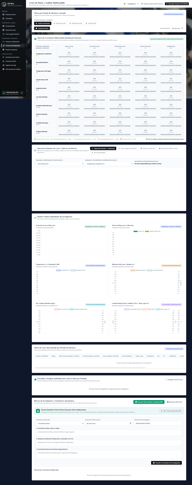
*Figura 8: Matriz de correlación de Pearson y gráficos de dispersión (`/cross_analysis`).*

Calcula los coeficientes de correlación lineal de Pearson ($r$) entre variables como Radiación vs. Tasa de Crecimiento Foliar, y Temperatura vs. Diámetro de Tallo, facilitando inferencias agronómicas respaldadas matemáticamente.

---

## 10. Dossier y Reporte Científico con Firma Digital

La vista del Dossier Científico (`/report/scientific`) compila una ficha técnica integral de la jornada en formato tipo informe editorial.

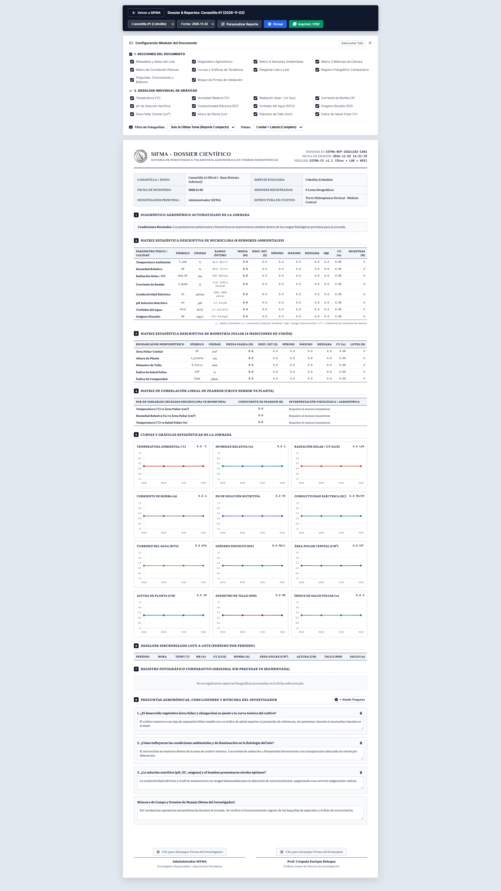
*Figura 9: Informe científico formal con configuración modular y panel de firmas (`/report/scientific`).*

### Funcionalidades del Reporte:
- **Configuración Modular del Documento:** Panel desplegable para activar o desactivar secciones específicas (Metadatos, Diagnóstico, Matrices de Sensores, Gráficas Individuales, Fotografías, Bitácora y Firmas).
- **Estilo Editorial Formal:** Diseño sobrio en escala de grises y azul institucional, sin emojis ni elementos gráficos informales.
- **Suite de Firma Digital:** Permite al investigador y al director de proyecto firmar en pantalla táctil o con el ratón. La firma se estampa con sello de tiempo y cargo.
- **Exportación PDF:** Optimizado mediante reglas `@media print` para generar documentos en tamaño A4 listos para impresión o archivo documental.

---

## 11. Calibración y Parámetros de Cultivo

El módulo de configuración (`/config`) define los umbrales de segmentación y los factores de escala óptica.

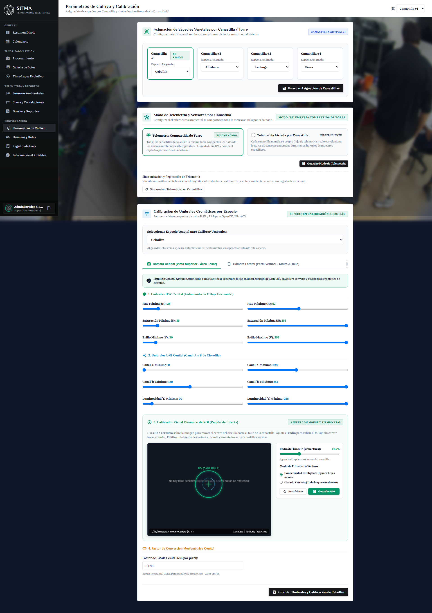
*Figura 10: Calibración de perfiles botánicos y canvas interactivos (`/config`).*

Permite ajustar de forma visual mediante deslizadores:
- Factor de conversión píxel a centímetro cuadrado ($ratio_{cm^2}$).
- Umbrales de color HSV y LAB para especies específicas (Cebollín, Lechuga, Albahaca, Cilantro, etc.).
- Delimitador del círculo central de la canastilla (ROI) para aislar la planta de las vecinas.

---

## 12. Gestión de Usuarios y Roles RBAC

El módulo de usuarios (`/users`) gestiona los operadores autorizados del sistema.


*Figura 11: Panel de administración de cuentas y asignación de roles (`/users`).*

### Roles Disponibles:
1. **Administrador del Sistema:** Acceso total a configuración, auditoría y base de datos.
2. **Investigador Agrónomo:** Acceso a análisis, procesamiento, bitácora y emisión de reportes.
3. **Operador de Campo:** Acceso limitado a carga de fotografías y visualización de telemetría.
4. **Invitado / Lector:** Acceso de solo lectura para consulta de resultados.

---

## 13. Registro de Auditoría y Trazabilidad

El registro de auditoría (`/audit_logs`) documenta cada movimiento realizado dentro de la aplicación, garantizando trazabilidad y no repudio.

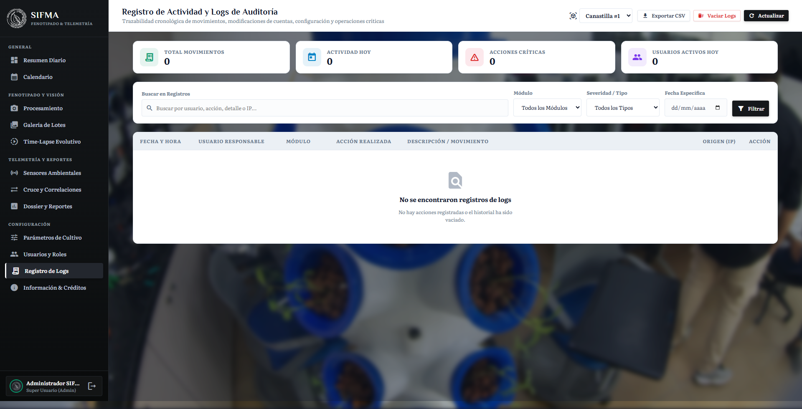
*Figura 12: Tabla de auditoría y bitácora de eventos del sistema (`/audit_logs`).*

Registra la fecha y hora exacta, usuario responsable, módulo afectado, acción ejecutada (creación, edición, eliminación o exportación) y dirección IP de origen.

---

## 14. Información del Sistema

La vista de diagnóstico (`/about` o `/system_info`) detalla el entorno de ejecución y las versiones de las librerías activas.

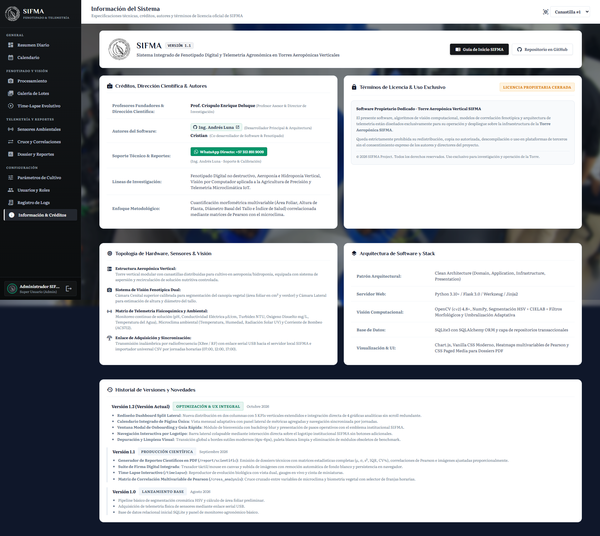
*Figura 13: Especificaciones técnicas de hardware y entorno de software (`/system_info`).*

---

## 15. Procedimientos de Contingencia y Resolución de Problemas

### 15.1 El Puerto Serial / Antena USB no Conecta
1. Desconecte y vuelva a conectar la antena receptora USB en otro puerto del equipo.
2. Ingrese a la vista de **Configuración** (`/config`).
3. En la sección *Receptor de Telemetría*, presione **"Escanear Puertos COM"**.
4. Seleccione el puerto correspondiente (ej. `COM3` o `/dev/ttyUSB0`) y haga clic en **"Probar Conexión"**.

### 15.2 La Memoria USB no es Detectada por el Servidor
1. Asegúrese de que la memoria USB esté formateada en sistema de archivos FAT32, exFAT o NTFS.
2. Verifique que la carpeta raíz de capturas se denomine exactamente `SIFMA_CAPTURES`.
3. Si el sistema no monta la unidad automáticamente, use el botón **"Carga Manual (Arrastrar Archivo)"** en `/processing` para seleccionar la carpeta o archivo ZIP directamente.

### 15.3 Anomalías en la Segmentación (Bajo Contraste o Clorosis Extrema)
1. Ingrese a **Configuración** (`/config`) y seleccione el perfil de la especie evaluada.
2. En el panel de *Umbrales de Color HSV*, amplíe el rango de matiz mínimo ($H_{min}$) a 20 para permitir la detección de hojas amarillentas o en senescencia.
3. Ajuste el *Canal A de LAB* a un valor inferior a 126 para anular reflejos blanquecinos intensos.
4. Presione **"Guardar Calibración"** y reprocese el lote desde `/processing`.

---

## 16. Operación del Nodo Embebido en Campo (Raspberry Pi 5)

El subsistema embebido de campo (`raspi_node/`) opera de manera autónoma en una computadora de placa reducida Raspberry Pi 5 instalada físicamente en la estructura de la torre hidropónica. Este subsistema garantiza la toma sincronizada de fotografías científicas sin depender de conectividad a redes de datos externas.

### 16.1 Arquitectura Física del Nodo
- **Cámara Cenital (Puerto `CAM/DISP 0`):** Sensor óptico de alta resolución instalado en la cúspide de la estructura con ángulo perpendicular hacia el plano horizontal del dosel vegetal.
- **Cámara Lateral (Puerto `CAM/DISP 1`):** Sensor óptico alineado horizontalmente con el borde superior de la canastilla de cultivo para medir la altura apical y el diámetro basal del tallo.
- **Pantalla Táctil Oficial DSI:** Permite la interacción táctil directa en campo sin requerir periféricos de escritorio (teclado ni ratón).
- **Memoria USB Extraíble:** Unidad flash dedicada para almacenar de manera segura los lotes fotográficos diarios bajo la ruta `SIFMA_CAPTURES/YYYY-MM-DD/`.

### 16.2 Despliegue e Instalación Asistida
En una terminal de Raspberry Pi OS, ingrese al directorio del nodo y ejecute el instalador unificado:

```bash
cd ~/raspi_node
bash instalacion/instalar_todo.sh
```

El script ejecuta en secuencia los tres módulos de configuración:
1. `instalacion/1_configurar_camaras_dual.sh`: Configura el archivo `/boot/firmware/config.txt` con los overlays específicos del sensor Arducam (OV5647, IMX219, IMX708 o IMX477). *Requiere reiniciar el equipo con `sudo reboot`.*
2. `instalacion/2_instalar_dependencias.sh`: Instala las librerías nativas de captura (`python3-picamera2`, `libcamera-apps`) y dependencias Python (`pillow`, `opencv-python-headless`, `psutil`).
3. `instalacion/3_activar_servicio_autonomo.sh`: Registra el demonio del sistema `sifma-capture.service` en `systemd` para arranque desatendido al encender la torre, y crea los accesos directos en el Escritorio.

### 16.3 Calibración y Enfoque Óptico de Cámaras
Antes de dar inicio a un ciclo experimental, es indispensable verificar la nitidez y el plano focal:
1. En el Escritorio de la Raspberry Pi, haga doble clic sobre el acceso directo **"SIFMA Calibración de Cámaras CSI"** (o ejecute `python3 calibrate_cameras.py`).
2. Se iniciará una transmisión de video en tiempo real de ambas cámaras a 30 fotogramas por segundo.
3. Gire manualmente el anillo de enfoque del lente de cada cámara hasta que el perímetro foliar y las nervaduras presenten nitidez máxima.
4. Verifique que la canastilla central se encuentre dentro del encuadre y que no existan reflejos especulares intensos provenientes de luminarias directas.
5. Cierre la herramienta de calibración.

### 16.4 Operación Diaria con el Panel Táctil Lite
Para la operación en campo sin teclado ni ratón:
1. Haga doble clic en el acceso directo **"SIFMA Control Táctil Lite"** en la pantalla del nodo (o ejecute `python3 panel_touch_lite.py`).
2. La interfaz de bajo consumo (<15 MB de RAM) presenta los siguientes controles táctiles:
   - **Indicador de Estado:** Confirma si el demonio autónomo está en espera, capturando o en reposo.
   - **Selector de Canastilla / Estrato:** Permite rotar el registro entre el Nivel 1 (Base) y el Nivel 4 (Cúspide).
   - **Botón "Captura Manual":** Dispara una secuencia instantánea de fotografías fuera de las horas programadas.
   - **Indicador de Unidad USB:** Muestra el espacio libre restante en la memoria USB insertada.

### 16.5 Protocolo de Muestreo Autónomo y Extracción Segura de USB
1. Al encender la torre hidropónica, el demonio `main_capture.py` arranca en segundo plano y espera un retardo inicial de seguridad de 10 segundos para estabilización de voltajes.
2. En las franjas horarias programadas en `config.json` (por defecto: 07:05, 12:05 y 17:05), el sistema adquiere ráfagas dobles ortogonales sincronizadas.
3. Las imágenes se almacenan organizadas por fecha:
   ```text
   SIFMA_CAPTURES/2026-11-02/
   ├── plant1_2026-11-02_07-05-00_cenital_01.jpg
   ├── plant1_2026-11-02_07-05-00_lateral_01.jpg
   ├── plant1_2026-11-02_12-05-00_cenital_01.jpg
   └── plant1_2026-11-02_12-05-00_lateral_01.jpg
   ```
4. El software ejecuta una llamada al sistema `os.sync()` tras finalizar la escritura de cada archivo, garantizando que no queden datos pendientes en la memoria caché del kernel.
5. El operador puede retirar físicamente la memoria USB en cualquier momento fuera de las horas de muestreo programadas y conectarla a la estación de trabajo central para procesamiento en el módulo `/processing` de SIFMA.

### 16.6 Comandos de Mantenimiento y Diagnóstico
- **Verificar estado del servicio autónomo:**
  ```bash
  sudo systemctl status sifma-capture
  ```
- **Inspeccionar registros de eventos en tiempo real:**
  ```bash
  journalctl -u sifma-capture -f
  ```
- **Ejecutar un muestreo manual de prueba por terminal:**
  ```bash
  python3 main_capture.py --now
  ```


